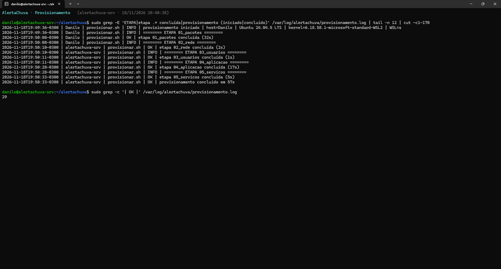
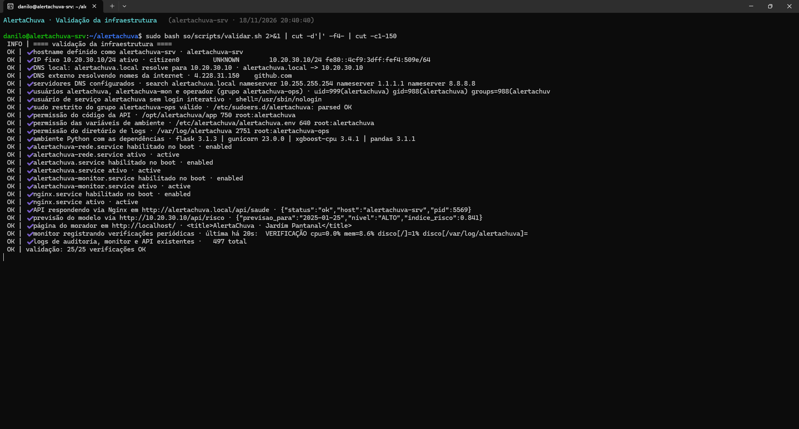
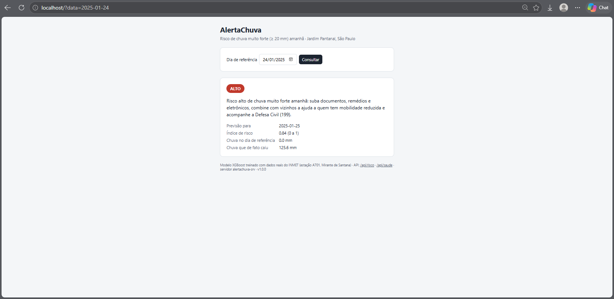
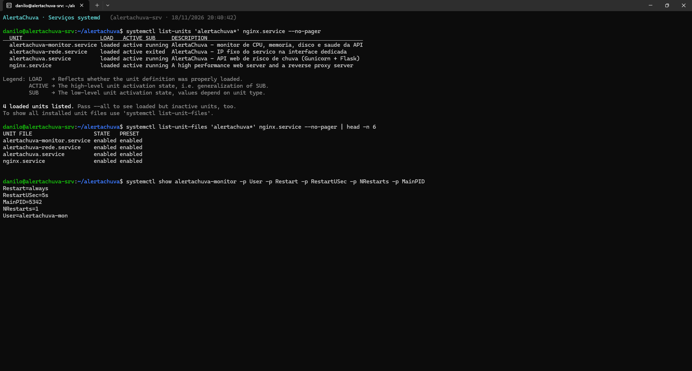
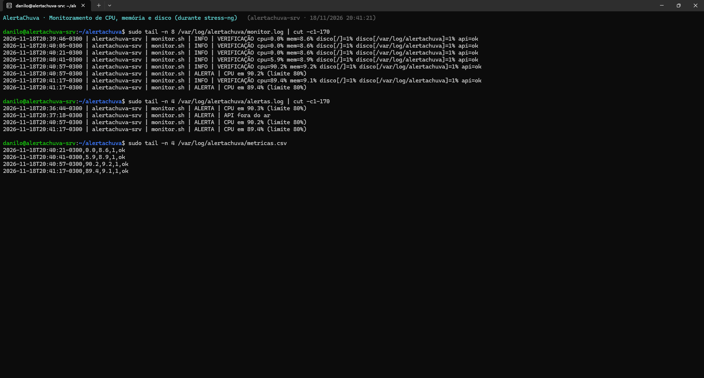
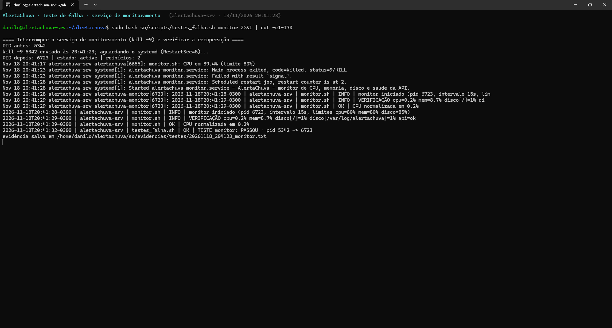
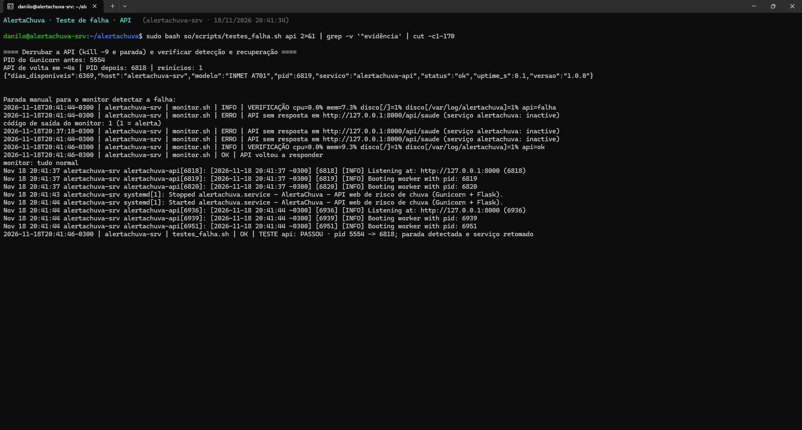
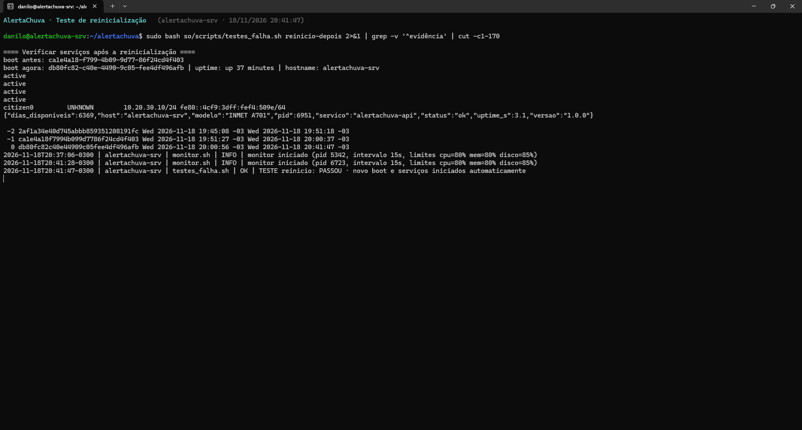
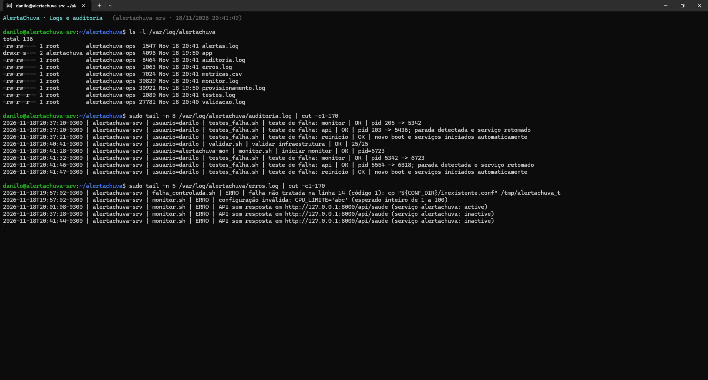

# AlertaChuva · Operating System (Linux)

**Global Solution 2026.2 · CitizenTech · Engenharia de Software (3º ano)**
**Integrantes:** Danilo Affonso Luz Rios (RM 554791) · Lucca Natario do Vale (RM 95688) · Thiago Feltrin Geraldes (RM 555805)

Infraestrutura Linux **provisionada só por scripts Bash** para hospedar a **API AlertaChuva**. A API é a aplicação web do projeto: ela usa o modelo XGBoost da disciplina de IA & ML (dados reais do INMET) para dizer ao morador do Jardim Pantanal se o risco de chuva muito forte amanhã é BAIXO, ATENÇÃO ou ALTO, e o que fazer.

Ambiente escolhido: **WSL 2 com Ubuntu 22.04 ou 24.04 e systemd**. Os mesmos scripts também funcionam numa VM Ubuntu (VirtualBox, Hyper-V ou Azure).

## Arquitetura

```
 Navegador / curl
        │  http://alertachuva.local  ·  http://10.20.30.10  ·  http://localhost
        ▼
 nginx.service ── proxy reverso :80 ──► alertachuva.service (Gunicorn :8000, usuário alertachuva)
                                              │  Flask + modelo XGBoost (modelo/) + dados INMET A701 (dados/)
 alertachuva-rede.service ── IP fixo 10.20.30.10/24 na interface citizen0
 alertachuva-monitor.service ── monitor.sh --continuo (usuário alertachuva-mon)
        │  CPU · memória · disco · saúde da API a cada 15 s
        ▼
 /var/log/alertachuva/  monitor.log · alertas.log · metricas.csv · erros.log · auditoria.log · provisionamento.log · app/app.log
```

## Como reproduzir o ambiente

1. **Instalar o WSL** (PowerShell como administrador, só na primeira vez):
   ```powershell
   wsl --install -d Ubuntu-24.04
   ```
2. **Clonar o repositório dentro do Linux** (no Ubuntu, não em `/mnt/c`, para manter as permissões e as quebras de linha do Linux):
   ```bash
   git clone https://github.com/DaniloALR/Alerta-Chuva-OS.git ~/Alerta-Chuva-OS
   cd ~/Alerta-Chuva-OS
   ```
3. **Provisionar** (instala, configura, sobe os serviços e roda a validação no final):
   ```bash
   sudo bash scripts/provisionar.sh
   ```
   Se o systemd ainda não estiver ligado no WSL, o script liga o systemd no `/etc/wsl.conf` e pede para reiniciar o WSL. Nesse caso, rode `wsl --shutdown` no PowerShell, abra o Ubuntu de novo e repita o comando.
4. **Reiniciar uma vez** para o hostname `alertachuva-srv` valer em definitivo: `wsl --shutdown` no PowerShell e abra o Ubuntu (numa VM, `sudo reboot`). Os serviços sobem sozinhos.
5. **Acessar**: `http://localhost` no navegador do Windows, ou `curl http://alertachuva.local/api/saude` no Ubuntu.

Para recomeçar do zero: `sudo bash scripts/desinstalar.sh` e depois `sudo bash scripts/provisionar.sh`. Todos os scripts são idempotentes: rodar de novo não duplica configuração.

Os parâmetros do ambiente (hostname, IP, DNS, usuários, diretórios, limites do monitor) ficam em [`config/infra.conf`](config/infra.conf).

## Estrutura do repositório

| Pasta | Conteúdo |
|---|---|
| [`scripts/`](scripts/) | Provisionamento, monitoramento, validação, testes de falha e evidências (Bash) |
| [`config/`](config/) | Parâmetros da infraestrutura (`infra.conf`), unidades systemd e site do Nginx |
| [`app/`](app/) | API AlertaChuva (Flask), página do morador e dependências Python |
| [`modelo/`](modelo/) | Modelo XGBoost treinado na disciplina de IA & ML |
| [`dados/`](dados/) | Série diária real do INMET (estação A701) usada pela API |
| [`evidencias/`](evidencias/) | Saídas em texto, testes de falha e capturas de tela |

## O que cada script faz

| Script | Requisito atendido |
|---|---|
| [`provisionar.sh`](scripts/provisionar.sh) | Orquestra as etapas 01 a 05, para no primeiro erro, registra cada etapa e roda a validação |
| [`01_pacotes.sh`](scripts/01_pacotes.sh) | Instala Python, venv, Nginx, curl, jq, dnsutils, iproute2, stress-ng e logrotate, e registra a versão de cada pacote |
| [`02_rede.sh`](scripts/02_rede.sh) | Hostname `alertachuva-srv`, `/etc/wsl.conf` (systemd, hostname e DNS fixos), `/etc/hosts` com `alertachuva.local`, IP fixo `10.20.30.10/24`, parâmetros de rede (sysctl) e DNS (`1.1.1.1`, `8.8.8.8`, domínio de busca `alertachuva.local`) |
| [`rede.sh`](scripts/rede.sh) | Cria a interface `citizen0` com o IP fixo; é chamado pelo serviço `alertachuva-rede` a cada boot |
| [`03_usuarios.sh`](scripts/03_usuarios.sh) | Grupos, usuários de serviço sem login, usuário `operador` e sudo restrito aos serviços do projeto |
| [`04_aplicacao.sh`](scripts/04_aplicacao.sh) | Diretórios, cópia da API, do modelo e dos dados, ambiente Python, variáveis de ambiente, permissões e logrotate |
| [`05_servicos.sh`](scripts/05_servicos.sh) | Instala as unidades systemd, configura o Nginx, habilita a inicialização automática e espera a API responder |
| [`monitor.sh`](scripts/monitor.sh) | Monitoramento de CPU, RAM, disco e saúde da API, com alertas (`--uma-vez` ou `--continuo`) |
| [`validar.sh`](scripts/validar.sh) | 25 verificações: rede, DNS, usuários, permissões, serviços, API, monitor e logs |
| [`testes_falha.sh`](scripts/testes_falha.sh) | Testes de falha e recuperação, com evidência salva em `evidencias/testes/` |
| [`falha_controlada.sh`](scripts/falha_controlada.sh) | Script que falha de propósito, para provar que o erro é registrado |
| [`coletar_evidencias.sh`](scripts/coletar_evidencias.sh) | Gera as evidências técnicas em texto em `evidencias/` |
| [`capturar_telas.sh`](scripts/capturar_telas.sh) | Gera as 9 capturas de tela das evidências em `evidencias/capturas/` (WSL) |
| [`desinstalar.sh`](scripts/desinstalar.sh) | Remove tudo e restaura hosts, DNS e wsl.conf originais (mantém os logs para auditoria) |
| [`lib/comum.sh`](scripts/lib/comum.sh) | Funções de log, auditoria, execução de etapas e captura de erros (`trap ERR`) usadas por todos os scripts |

## Usuários e permissões

| Conta | Tipo | Para quê |
|---|---|---|
| `alertachuva` | serviço, sem login | Roda a API. Só lê o código e o modelo, e só escreve em `/var/log/alertachuva/app` |
| `alertachuva-mon` | serviço, sem login | Roda o monitor. Escreve nos logs de monitoramento e em `/var/lib/alertachuva` |
| `operador` | humano, grupo `alertachuva-ops` | Lê os logs e pode iniciar, parar, reiniciar e ver o status dos serviços do projeto via sudo, e nada além disso |
| seu usuário do WSL | humano | Adicionado ao grupo `alertachuva-ops` pelo provisionamento |

| Caminho | Dono e modo | Motivo |
|---|---|---|
| `/opt/alertachuva/app`, `modelo`, `dados`, `venv` | `root:alertachuva 750/640` | A API lê, mas não altera o próprio código |
| `/etc/alertachuva/alertachuva.env` | `root:alertachuva 640` | Variáveis da API, sem leitura para outros usuários |
| `/etc/alertachuva/monitor.env` | `root:alertachuva-ops 640` | Limites e intervalo do monitor |
| `/var/log/alertachuva` | `root:alertachuva-ops 2751` | Só o grupo de operação lê os logs; o setgid mantém o grupo nos arquivos |
| `/etc/sudoers.d/alertachuva` | `root:root 440` | Validado com `visudo -c` antes de instalar |

Os serviços também rodam com `NoNewPrivileges`, `ProtectSystem=strict`, `ProtectHome` e `PrivateTmp`.

## Serviços systemd

| Unidade | Tipo | Tolerância a falhas |
|---|---|---|
| [`alertachuva.service`](config/systemd/alertachuva.service) | Gunicorn com 2 workers | `Restart=always` em 3 s |
| [`alertachuva-monitor.service`](config/systemd/alertachuva-monitor.service) | `monitor.sh --continuo` | `Restart=always` em 5 s, até 10 reinícios a cada 2 min |
| [`alertachuva-rede.service`](config/systemd/alertachuva-rede.service) | oneshot | Recria o IP fixo a cada boot |
| `nginx.service` | proxy reverso ([config](config/nginx/alertachuva.conf)) | Padrão do pacote |

```bash
systemctl status alertachuva alertachuva-monitor alertachuva-rede nginx
sudo systemctl stop|start|restart alertachuva-monitor
journalctl -u alertachuva-monitor -f
```

## Monitoramento

O monitor lê `/proc/stat` (CPU, duas amostras com 1 s de intervalo), `/proc/meminfo` (RAM usada = total − disponível) e `df` (disco de `/` e de `/var/log/alertachuva`). Ele também consulta `/api/saude`. Os limites padrão são **CPU 80%**, **RAM 80%** e **disco 85%**, com uma verificação a cada **15 s**.

- Cada verificação gera uma linha `VERIFICAÇÃO` em `monitor.log` e uma linha em `metricas.csv`.
- Quando um limite é ultrapassado, o monitor grava um `ALERTA` em `monitor.log` e em `alertas.log` e envia um aviso ao journal (`logger -p user.warning`).
- Quando o consumo volta ao normal, ele registra a normalização (por exemplo, `CPU normalizada em 12%`).
- Se a API parar de responder, ele grava um `ERRO` em `erros.log` e, quando ela volta, registra `API voltou a responder`.
- Um limite inválido no `monitor.env` faz o monitor sair com código 2 e registrar o erro.

```bash
sudo -u alertachuva-mon /opt/alertachuva/bin/monitor.sh --uma-vez
```

## Logs e auditoria

Formato de todas as linhas: `data-hora | host | script | nível | mensagem`.

| Arquivo | Conteúdo |
|---|---|
| `provisionamento.log` | Cada etapa com INÍCIO, OK ou ERRO, duração e a saída completa dos comandos |
| `auditoria.log` | Uma linha por operação: quem executou, o quê, quando e qual foi o resultado |
| `monitor.log` / `metricas.csv` | Verificações periódicas e série histórica de CPU, RAM, disco e API |
| `alertas.log` | Somente os alertas de consumo elevado e de API fora do ar |
| `erros.log` | Todos os erros de todos os scripts, com linha, comando e código de saída |
| `testes.log` / `validacao.log` | Resultados dos testes de falha e das validações |
| `app/app.log` | Requisições e eventos da API (com rotação) |
| journal | `journalctl -u alertachuva -u alertachuva-monitor` e `journalctl -t alertachuva` |

A rotação semanal dos logs é feita pelo logrotate (`/etc/logrotate.d/alertachuva`).

## Testes de falha

```bash
sudo bash scripts/testes_falha.sh todos            # monitor, api, cpu, memoria, disco, script
sudo bash scripts/testes_falha.sh reinicio-antes   # depois: wsl --shutdown (PowerShell) e abrir o Ubuntu
sudo bash scripts/testes_falha.sh reinicio-depois
```

| Teste | O que acontece | O que comprova |
|---|---|---|
| `monitor` | `kill -9` no processo do monitor | O systemd sobe outro processo (PID novo) em cerca de 5 s |
| `api` | `kill -9` no Gunicorn e depois `systemctl stop` | A API volta sozinha; com o serviço parado, o monitor registra `API sem resposta` e, quando ele volta, registra a recuperação |
| `cpu` | `stress-ng` em todos os núcleos por 45 s | O serviço gera `ALERTA CPU` e depois a normalização |
| `memoria` | Ocupa a RAM até o limite + 8 pontos por 40 s | O serviço gera `ALERTA MEMÓRIA` |
| `disco` | Verificação com o limite de disco reduzido para 1 ponto abaixo do uso atual | `ALERTA DISCO`, sem precisar encher o disco de verdade |
| `script` | `falha_controlada.sh` e o monitor com `CPU_LIMITE=abc` | O erro vai para `erros.log` e `auditoria.log` com a linha, o comando e o código |
| `reinicio` | Reinício do WSL ou da VM | Boot novo (`boot_id` diferente) com os 4 serviços ativos e o IP fixo de volta, sem intervenção manual |

## Evidências

- **Texto:** `sudo bash scripts/coletar_evidencias.sh` gera `evidencias/01` a `07`, e os testes de falha salvam a saída em `evidencias/testes/`.
- **Capturas de tela:** `bash scripts/capturar_telas.sh` (com o terminal maximizado) mostra cada evidência no terminal e fotografa a janela pelo próprio Windows, salvando em `evidencias/capturas/`. Detalhes em [`evidencias/README.md`](evidencias/README.md).

### Provisionamento e validação





### Aplicação CitizenTech funcionando



### Serviços systemd



### Monitoramento



### Testes de falha e recuperação







### Logs e auditoria



## Solução de problemas

- **`$'\r': command not found`**: o repositório foi clonado no Windows com CRLF. Clone dentro do Ubuntu. O `.gitattributes` já força LF nos scripts.
- **A porta 80 não abre no Windows**: verifique se outro programa usa a porta 80 no Windows (IIS, Skype antigo) e acesse `http://localhost`.
- **`System has not been booted with systemd`**: rode `wsl --shutdown` no PowerShell e abra o Ubuntu de novo; o provisionamento já deixou `systemd=true` no `/etc/wsl.conf`.
